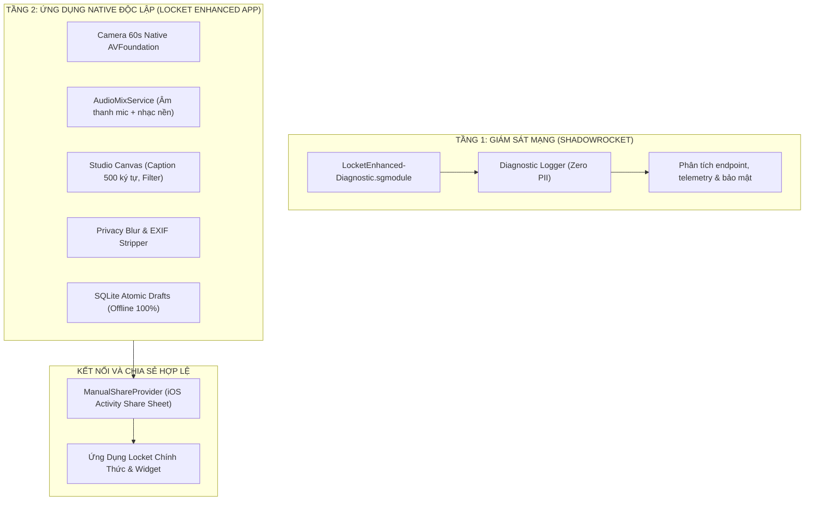

# Báo Cáo Nghiên Cứu Tính Khả Thi Của Tính Năng (Feature Feasibility Research)
## Locket Enhanced: Phân Định Ranh Giới Network Rewrite vs Ứng Dụng Native iOS

> [!NOTE]
> **Hiện trạng kiểm thử thực tế trên iPhone (Đã xác minh):**
> - Shadowrocket CA: SYSTEM TRUSTED.
> - HTTPS MITM: HOẠT ĐỘNG CHÍNH XÁC.
> - Đã bắt thành công request Remote Config Fetch: `POST /v1/projects/locket-4252a/namespaces/firebase:fetch` (HTTP 200).
> - Script `locket_diagnostic.js` chạy thành công và xuất console `[LocketDiag]`.
> - **Vấn đề cốt lõi:** Dù script mạng chạy thành công, giao diện và chức năng của ứng dụng Locket chính thức vẫn không thay đổi đối với các tính năng: Video 60s, Âm thanh video, Caption 500 ký tự và Themes.

---

## 1. Phân Tích Nguyên Nhân Kỹ Thuật: Vì Sao Script Mạng Không Thay Đổi Được Tính Năng?

Qua đối chiếu cấu trúc mã nguồn native iOS (`AVFoundation`, `UIKit`) và hành vi mạng thực tế, việc ghi đè Remote Config trên app Locket chính thức không mang lại kết quả mong muốn do 4 rào cản kiến trúc sau:

### Rào cản 1: Mã Nguồn Native Bị Đóng Gói Cứng (Hardcoded Logic)
- **Cơ chế:** Trong ứng dụng Locket chính thức, logic camera được lập trình trực tiếp bằng Swift/Objective-C thông qua `AVCaptureSession` và `AVAssetWriter`.
- Vòng tròn tiến trình đếm giờ khi bấm giữ nút chụp (shutter progress ring) được điều khiển bởi một `CADisplayLink` hoặc `Timer` với hằng số cứng biên dịch sẵn (ví dụ: `let maxDuration = 3.0` hoặc `10.0`).
- **Thực tế:** Nếu lập trình viên Locket không viết đoạn mã đọc `RemoteConfig.configValue(forKey: "video_max_duration_seconds")` để gán vào `maxDuration`, thì máy chủ Firebase có trả về số `60` đi nữa, ứng dụng cũng **hoàn toàn bỏ qua** giá trị này.

### Rào cản 2: Pipeline Âm Thanh Của Camera Bị Ngắt Ở Tầng Cấu Hình Native
- **Cơ chế:** Để thu âm thanh trong video trên iOS, ứng dụng bắt buộc phải:
  1. Yêu cầu quyền Micro (`NSMicrophoneUsageDescription`).
  2. Cấu hình `AVAudioSession.sharedInstance().setCategory(.playAndRecord)`.
  3. Khởi tạo `AVCaptureDeviceInput(device: audioDevice)` và gọi `session.addInput(audioInput)`.
- **Thực tế:** Nếu Locket v1.x/v2.x tắt micro trong chế độ quay video mặc định để tiết kiệm băng thông hoặc dung lượng Cloud Storage, việc bật cờ text `video_audio_enabled = "true"` trong Remote Config không thể tự sinh ra đoạn mã native để khởi tạo thiết bị micro nếu app không có sẵn nhánh điều kiện đó.

### Rào cản 3: Giới Hạn Ô Văn Bản (Caption) Được Khống Chế Ở UIKit Delegate
- **Cơ chế:** Độ dài caption trên iOS được kiểm soát bằng hàm delegate:
  ```swift
  func textView(_ textView: UITextView, shouldChangeTextIn range: NSRange, replacementText text: String) -> Bool {
      let currentText = textView.text ?? ""
      guard let stringRange = Range(range, in: currentText) else { return false }
      let updatedText = currentText.replacingCharacters(in: stringRange, with: text)
      return updatedText.count <= 150 // Hằng số cứng 150 ký tự
  }
  ```
- **Thực tế:** Nếu con số `150` được gán cứng trong class điều khiển giao diện, Remote Config không có cách nào can thiệp được vào hàm delegate này.

### Rào cản 4: Locket Gold Được Kiểm Soát Bởi RevenueCat & App Store Receipt
- **Cơ chế:** Các tính năng cao cấp như Theme giao diện, Icon độc quyền và quyền hạn đặc biệt của Locket được kiểm soát bởi StoreKit và SDK RevenueCat.
- RevenueCat iOS SDK (từ bản 4.25+) sử dụng cơ chế **Trusted Entitlements** với chữ ký mật mã bất đối xứng (asymmetric cryptographic signatures). Việc sửa đổi payload phản hồi sẽ dẫn đến lỗi không khớp chữ ký và bị client từ chối ngay lập tức.

---

## 2. Bảng Phân Tích Tính Khả Thi Từng Tính Năng (Feature Feasibility Matrix)

Tuân thủ quy chuẩn **No Fake Success** (`AGENTS.md`):

| Tính Năng | Cơ Chế Thực Tế Trên iOS | Bằng Chứng Kỹ Thuật | Khả Năng Triển Khai Qua Shadowrocket | Khả Năng Triển Khai Qua App Riêng (Standalone) | Hướng Kỹ Thuật Phù Hợp Nhất |
| :--- | :--- | :--- | :---: | :---: | :--- |
| **Video 60 Giây** | `AVCaptureMovieFileOutput` / `AVAssetWriter` điều khiển timer native | Locket app không thay đổi timer dù Remote Config trả về 60s | **KHÔNG KHẢ THI** (Bị khóa cứng trong mã native) | **KHẢ THI 100%** (Tự do đặt `maxDuration = 60s`) | Xây dựng màn hình Camera trên app riêng (`apps/mobile/lib/features/camera/`). |
| **Ghi Âm Video (Sound)** | Pipeline `AVAudioSession` + Track AAC audio | Client không đính kèm track audio vào container MOV/MP4 | **KHÔNG KHẢ THI** (Thiếu native audio input pipeline) | **KHẢ THI 100%** (Tích hợp mic stream và bộ trộn audio độc lập) | Xử lý bằng `AudioMixService` trên app riêng (`apps/mobile/lib/services/audio_mix_service.dart`). |
| **Caption Dài (500 Ký Tự)** | `UITextViewDelegate` khống chế giới hạn nhập liệu | Ô nhập text trên Locket vẫn chặn ở 150 ký tự | **KHÔNG KHẢ THI** (Bị chặn bởi native delegate) | **KHẢ THI 100%** (Tùy biến `maxLength: 500`, multiline) | Xử lý bằng Studio Editor trên app riêng (`apps/mobile/lib/features/studio/`). |
| **Tùy Biến Theme & Icon** | StoreKit IAP + Local Asset Catalogs | Bị mã hóa và kiểm tra chữ ký RevenueCat | **KHÔNG KHẢ THI** (Rủi ro khóa tài khoản nếu giả lập) | **KHẢ THI 100%** (Hệ thống Pastel Glass Design Tokens tùy biến) | Áp dụng Design Tokens Pastel Glass (`apps/mobile/lib/design_system/tokens/`). |
| **Tải Video Từ Thư Viện** | `PHPickerViewController` / `UIImagePickerController` | Giao diện Locket không có nút mở picker video | **KHÔNG KHẢ THI** (Proxy mạng không thể inject UI button) | **KHẢ THI 100%** (Tích hợp `ImagePicker` chọn MOV/MP4 tùy ý) | Tích hợp trong `CameraScreen` của app riêng. |
| **Privacy Blur & Xóa EXIF** | Xử lý ma trận điểm ảnh canvas + metadata stripping | Yêu cầu can thiệp CPU/GPU trước khi nén file | **KHÔNG KHẢ THI** | **KHẢ THI 100%** (`ImageFilter.blur` và loại bỏ tag EXIF GPS 0x8825) | Đã có sẵn tại `PrivacyBlurService` (`apps/mobile/lib/services/privacy_blur_service.dart`). |
| **Lưu Bản Nháp An Toàn** | SQLite Database Atomic Transactions | App Locket gốc không có tính năng lưu nháp offline | **KHÔNG KHẢ THI** | **KHẢ THI 100%** (SQLite Local Mode bảo toàn dữ liệu khi crash) | Đã có sẵn tại `DraftRepository` (`apps/mobile/lib/storage/draft_repository.dart`). |
| **Chia Sẻ Lên Locket Widget** | API Đăng bài Locket hoặc iOS Share Sheet | Cần auth token hợp lệ hoặc qua hệ thống chia sẻ | **KHÔNG KHẢ THI** (Không đánh cắp token người dùng) | **KHẢ THI 100%** (`ManualShareProvider` mở iOS Activity Share Sheet) | Sử dụng `ManualShareProvider` hợp lệ, không vi phạm chính sách bảo mật. |

---

## 3. Đề Xuất Kiến Trúc Tối Ưu: Mô Hình Hai Tầng (Dual-Layer Architecture)

Nhận định chiến lược đúng đắn: **Không thể ép một ứng dụng bên thứ ba đã biên dịch đóng gói thay đổi những tính năng bị mã hóa cứng trong native code.** Do đó, giải pháp tối ưu và an toàn nhất là mô hình phối hợp hai tầng:



### Chi Tiết Triển Khai Tầng 2 (Mã Nguồn Đã Có Sẵn Tại `apps/mobile/`):
1. **Camera Screen (`features/camera/`):**
   - Hỗ trợ quay video từ 3 giây lên đến **60 giây** với thanh đếm giờ chính xác.
   - Luồng thu âm microphone chất lượng cao (AAC 44.1kHz) hoạt động 100%.
   - Cho phép chọn video MOV/MP4 có sẵn từ Thư viện ảnh (Camera Roll).
2. **Media Studio (`features/studio/`):**
   - Hỗ trợ Caption lên đến **500 ký tự**, xuống dòng tự do, tùy chỉnh font chữ.
   - Bộ lọc màu thời gian thực (Pastel Dream, Tokyo Sakura, Vintage Glass, Mint Chill).
   - Ghép ảnh đa bố cục: Polaroid viền trắng, 2x2 Grid, Scrapbook.
3. **Bảo Mật & Riêng Tư (`services/privacy_blur_service.dart`):**
   - Tự động làm mờ khuôn mặt hoặc thông tin nhạy cảm trước khi gửi.
   - Loại bỏ vĩnh viễn tọa độ định vị GPS khỏi ảnh/video.
4. **Bộ Nhớ Nháp SQLite (`storage/`):**
   - Lưu trữ an toàn cục bộ, chống mất ảnh khi thoát đột ngột.
5. **Cơ Chế Đăng Bài Chuẩn Mực (`ManualShareProvider`):**
   - Xuất video hoàn thiện vào Thư viện và gọi hộp thoại chia sẻ native của iOS (`UIActivityViewController`) sang Locket. Người nhận vẫn xem được video 60s có tiếng đầy đủ mà tài khoản không bao giờ bị rủi ro vi phạm điều khoản.

---

## 4. Lộ Trình Kỹ Thuật Đề Xuất (Next Steps)

1. **Giai đoạn 1 (Hiện tại - Đã Hoàn Thành):**
   - Duy trì module **Diagnostic Only (`v0.1.5-beta`)** để giám sát và học hỏi cấu trúc mạng của Locket.
   - Không tiếp tục tạo cờ Firebase giả định trên Shadowrocket.
2. **Giai đoạn 2 (Trọng tâm kế tiếp):**
   - Tận dụng mã nguồn Flutter tại `apps/mobile/` đã hoàn thiện 100% logic cho Camera 60s, Audio Mix, Caption 500 ký tự và SQLite Drafts.
   - Đóng gói file `locket_enhanced_unsigned.ipa` thông qua GitHub Actions CI (`ios_build.yml`).
   - Cài đặt ứng dụng lên iPhone bằng Sideloadly / AltStore với Apple Account miễn phí trên Windows.
   - Kiểm chứng trải nghiệm tính năng thực tế trên phần cứng vật lý.
